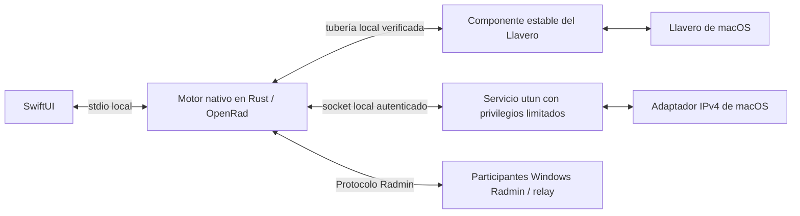

# Radmin VPN Mac

**Un cliente nativo de macOS para redes Radmin VPN existentes.**

Interfaz en SwiftUI, red nativa en Rust y un adaptador virtual de macOS. No requiere Wine,
CrossOver, Rosetta, servicios de Windows ni bibliotecas DLL propietarias.

[English](README.md) · [Русский](README.ru.md) · [Descargas](https://github.com/islamyus/radmin-vpn-mac/releases) · [Guía de compilación](docs/building.md) · [Solución de problemas](docs/troubleshooting.md)

> Proyecto comunitario independiente. No está afiliado ni respaldado por Famatech.
> Apple Silicon es la plataforma probada. Las compilaciones se firman localmente, **no
> cuentan con firma de Apple Developer ID ni notarización**.

## Características

- Únete a redes privadas Radmin VPN existentes y vuelve a conectarte con la misma identidad de dispositivo.
- Ventana nativa de SwiftUI con grupos de redes, selección por red, temas claro/oscuro,
  estado de participantes y mediciones de latencia autenticadas.
- Transportes TCP directo, UDP directo y relay mediante el motor [OpenRad](https://github.com/gringoestrangeiro/openrad).
- Tráfico IPv4 a través de un adaptador `utun` de macOS, con traducción Ethernet/ARP y MTU 1500.
- Credenciales del dispositivo en el Llavero de macOS; la aplicación no guarda contraseñas de red.
- Servicio de adaptador con privilegios limitados que se instala una sola vez, en lugar de pedir `sudo`
  en cada conexión.
- Pruebas opcionales de rendimiento e integridad entre Mac y Windows con verificación SHA-256.

## Instalación y conexión

1. Descarga un DMG desde [Releases](https://github.com/islamyus/radmin-vpn-mac/releases),
   ábrelo y copia **Radmin VPN.app** en **Aplicaciones**.
2. Abre la aplicación y pulsa el botón de encendido. Aprueba la instalación inicial
   del servicio del adaptador en el diálogo del sistema de macOS. El Llavero puede solicitar
   acceso por separado al dispositivo guardado, especialmente al actualizar desde una compilación
   de desarrollo anterior.
3. Elige **Red → Unirse a una red…** e ingresa el mismo nombre de red y contraseña
   que usan los participantes en Windows.
4. Espera a que el participante se conecte. Su dirección `26.x.x.x` podrá usarse luego
   en juegos y otras aplicaciones IPv4.

La interfaz está disponible en inglés, español y ruso, siguiendo el idioma del sistema
de macOS o el elegido en **Configuración → Conexión** (las traducciones están en
`Localization/<lang>.lproj/Localizable.strings`). Al volver a unirte no necesitas la
contraseña de la red una vez que la membresía ha quedado guardada en el servidor. La
autorización de administrador y la autorización del Llavero son permisos separados de macOS.

### Minecraft Java

En la computadora anfitriona, abre el mundo en LAN y anota el puerto mostrado en el chat.
En la otra computadora, ve a **Multijugador → Conexión directa** e ingresa
`<IP_Radmin_del_anfitrión>:<puerto_LAN>`. Ambos jugadores necesitan versiones de juego y
mods compatibles. El descubrimiento automático de mundos LAN a través del adaptador virtual
no está garantizado; conéctate directamente por IP y puerto.

## Compilar desde el código fuente

Requisitos: macOS 14+, Swift 6/Xcode, Rust 1.95+, Python 3 y las herramientas estándar
de línea de comandos de macOS. Instala Rust mediante [rustup](https://rustup.rs/).

```sh
git clone https://github.com/islamyus/radmin-vpn-mac.git
cd radmin-vpn-mac
zsh scripts/build-dmg.sh
```

El DMG y el `.app` autónomo se generan en `dist/`. Rust y Python son herramientas de
compilación; los usuarios finales no los necesitan para ejecutar la aplicación. Las
compilaciones desde código fuente crean una identidad privada de firma local bajo el
directorio ignorado `build/`; esas claves nunca forman parte de la app ni del repositorio público.

```sh
swift test
cargo test --manifest-path native/Cargo.toml --locked
cargo test --manifest-path vendor/openrad/Cargo.toml --lib --locked
```

Consulta [compilación y firma](docs/building.md) para ver verificaciones adicionales y empaquetado.
Las compilaciones desde código fuente en Intel no están cubiertas por las pruebas reales de interoperabilidad.

## Arquitectura



La aplicación y el motor de protocolo se ejecutan como el usuario actual. El servicio
privilegiado maneja únicamente el adaptador y sus rutas restringidas; no gestiona
autenticación ni credenciales de Radmin. Las instalaciones nuevas almacenan datos de
ejecución no secretos en `~/Library/Application Support/Radmin VPN/`. Los perfiles de
desarrollo existentes conservan su ubicación original y su cuenta del Llavero.

## Qué se ha probado

Las pruebas reales de interoperabilidad con clientes oficiales de Radmin VPN en Windows
cubrieron registro, membresía en redes privadas, TCP/UDP directo, relay, ping IPv4,
MTU 1500, transferencias bidireccionales con verificación SHA-256 y una conexión de
Minecraft Java. El usuario también confirmó un uso exitoso mediante punto de acceso móvil
y una VPN independiente. Estos son entornos específicos probados, no una garantía para
cada NAT, firewall o VPN externa.

La implementación actualmente transporta **IPv4**, no Ethernet arbitrario ni IPv6.
Algunas opciones de configuración y acciones de administración remota de la aplicación
de Windows no están implementadas. Modificar el pequeño componente del Llavero puede
requerir una nueva autorización; las recompilaciones habituales de la interfaz o del motor
reutilizan el mismo componente. Consulta [arquitectura y limitaciones](docs/architecture.md).

## Contribuir

Se agradecen reportes de errores, pruebas en macOS y pull requests enfocados. Incluye la
versión de macOS, arquitectura de CPU, versión de la app, tipo de transporte y el error exacto.
Oculta nombres de red, direcciones de dispositivos e información personal. Nunca adjuntes
exportaciones del Llavero, identidades, claves privadas ni capturas de paquetes sin censurar.

Lee [CONTRIBUTING.md](CONTRIBUTING.md) y [SECURITY.md](SECURITY.md).

## Licencia y créditos

El código del proyecto es **GPL-3.0-only**; consulta [LICENSE](LICENSE) y [NOTICE](NOTICE).
La copia incluida de OpenRad conserva su licencia MIT y los avisos de autoría; los cambios
GPL específicos de macOS están identificados en [vendor/openrad/LOCAL_CHANGES.md](vendor/openrad/LOCAL_CHANGES.md).

- [OpenRad](https://github.com/gringoestrangeiro/openrad) por estrangeiro,
  asimplestray y colaboradores proporciona el motor nativo de protocolo.
- [radmin-vpn-linux](https://github.com/baptisterajaut/radmin-vpn-linux) por
  baptisterajaut y colaboradores sirvió de base para la investigación del adaptador.
- Radmin VPN es un producto y marca comercial de Famatech. No se incluye ningún
  instalador, DLL, servicio ni controlador propietario de Radmin.
